# Preliminary Logical ERD

Status: **Conceptual draft; fields and retention require stakeholder review**

## 1. Relationship overview

```mermaid
erDiagram
    USER ||--o{ AUDIT_EVENT : acts_in
    USER ||--o{ HOUSEHOLD_MEMBERSHIP : records
    RESIDENT ||--o{ HOUSEHOLD_MEMBERSHIP : has
    HOUSEHOLD ||--o{ HOUSEHOLD_MEMBERSHIP : contains
    HOUSING_UNIT ||--o{ HOUSEHOLD_OCCUPANCY : accommodates
    HOUSEHOLD ||--o{ HOUSEHOLD_OCCUPANCY : occupies
    HOUSEHOLD ||--o{ HOUSEHOLD_SURVEY : surveyed
    HOUSEHOLD_SURVEY ||--o{ SURVEY_RESPONSE : contains
    RESIDENT ||--o{ HEALTH_DECLARATION : subject_of
    HOUSING_UNIT ||--o{ HOUSING_LOCATION : located_by
    GEO_BOUNDARY ||--o{ GEO_BOUNDARY : contains
    BARANGAY_SERVICE ||--o{ SERVICE_SCHEDULE : offers
    BARANGAY_SERVICE ||--o{ APPOINTMENT : requested_for
    RESIDENT o|--o{ APPOINTMENT : concerns
    APPOINTMENT ||--o{ APPOINTMENT_STATUS_EVENT : transitions
    COMPLAINT ||--o{ CASE_PARTY : involves
    RESIDENT o|--o{ CASE_PARTY : may_identify
    COMPLAINT ||--o{ CASE_ASSIGNMENT : assigned
    COMPLAINT ||--o{ CASE_ACTIVITY : records
    COMPLAINT ||--o{ ATTACHMENT : has
    IMPORT_BATCH ||--o{ STAGING_RECORD : contains
    STAGING_RECORD ||--o{ DATA_QUALITY_ISSUE : raises
```

## 2. Core entities and intended constraints

### Security and accountability

| Entity | Important attributes/constraints |
|---|---|
| User | Custom user from migration 0001; unique login; active state; privileged flags protected |
| Role / Permission / UserRole | Capability-based assignments; effective/expiry fields if required; role does not imply sensitive access |
| AuditEvent | Actor (nullable for system), action, target type/id, time, correlation/session context, result, reason; append-oriented |

### Profiling

| Entity | Important attributes/constraints |
|---|---|
| FormDefinition / FormField | Versioned draft/active/archived extension contract; typed keys, choices, sensitivity, and ordering; active contracts immutable |
| Resident | UUID; provisional core identity fields pending approval; birthdate and verification state; no stored age; typed extension values tied to an active form |
| ResidentRevision | Append-oriented resident/profile snapshot, actor, timestamp, and optional reason; access must be separately restricted |
| ResidentIdentifier | Type/value, issuer and validity subject to minimization; scoped uniqueness; protected display |
| DuplicateCandidate | Two distinct residents in canonical order, score/reasons, review status; never auto-merges |
| Household | UUID/reference, active state, established/closed dates; member count derived |
| HousingUnit | UUID/code, structural attributes, active state; no required geometry |
| HouseholdMembership | Resident, household, relationship, is_head, effective date range, recorded_by; preserve history |
| HouseholdOccupancy | Household, housing unit, effective date range; supports multiple households per unit and moves over time |
| HouseholdSurvey | Household, schema/version, observed_at, verification state/date/verifier, source |
| SurveyResponse | Survey and controlled question/value; sensitive classification where applicable |
| HealthDeclaration | Resident, approved condition/support category and effective dates; separately restricted |

Proposed invariants include end date after start date, at most one active membership
per resident if policy confirms that assumption, and at most one active household
head per household if stakeholders confirm single-head semantics. These are open
decisions and must not become constraints prematurely.

### GIS

| Entity | Important attributes/constraints |
|---|---|
| GeoBoundary | Type, name/code, geometry, source, source CRS, verification state/date, version; GiST index |
| HousingLocation | Housing unit, point, source/method, source CRS, accuracy value/unit, verification state, effective range, supersedes; GiST index |

A housing unit can have no active location. Corrections create a new location
version and retain the old record.

### Appointments

| Entity | Important attributes/constraints |
|---|---|
| BarangayService | Code/name, active state, duration/capacity policy after approval |
| ServiceSchedule | Service, local date/day applicability, operating interval, capacity, closure/exception semantics |
| Appointment | Unique reference, service, optional resident/contact subject, start/end, status, purpose-minimized notes |
| AppointmentStatusEvent | Appointment, from/to status, actor, timestamp, reason; immutable history |

Conflict enforcement may require transactional locking/exclusion constraints; its
exact design depends on whether capacity is per slot, per staff/resource, or per day.

### Complaints/cases

| Entity | Important attributes/constraints |
|---|---|
| Complaint | Unique reference, restricted details, category, incident date/location text, status, sensitivity |
| CaseParty | Complaint, role, optional resident link or minimized snapshot; access-restricted |
| CaseAssignment | Complaint, assignee/team, effective range, assigned_by |
| CaseActivity | Complaint, activity/status type, occurred_at, actor, restricted notes; append-oriented |
| Attachment | Owning case/activity, opaque storage key, original display name, size, detected MIME, hash, scan state |

Case workflow fields and retention remain subject to legal/privacy review.

### Migration and quality

| Entity | Important attributes/constraints |
|---|---|
| ImportBatch | Source, checksum, schema version, imported_by/time, status, counts |
| StagingRecord | Batch, source row key, raw protected payload, normalized payload, validation/reconciliation state |
| DataQualityIssue | Staging/canonical target, rule code, severity, status, reviewer, resolution |

Raw staging payload access and retention must be stricter than ordinary profiling
because it can contain uncontrolled sensitive fields.

## 3. Deletion and history policy

Foreign keys to historical/operational records default to `PROTECT`/`RESTRICT` or
nullable actor references, not broad cascading deletion. Reference-data deletion
is blocked when used. User deactivation preserves audit ownership. Retention-driven
disposal must be an explicit, approved, audited workflow that accounts for backups.

## 4. Items needed before physical schema

- Approved field-level data dictionary and collection purposes
- Filipino naming/identity and household business rules
- Identifier/reference-number policy
- Household-head and concurrent-membership rules
- Survey versions and controlled vocabularies
- Spatial CRS, accuracy representation, and coordinate collection method
- Appointment capacity/resource semantics
- Complaint workflow, access, attachment, and retention rules
- Audit-log and migration-staging retention
- Expected volumes and query patterns for indexing

